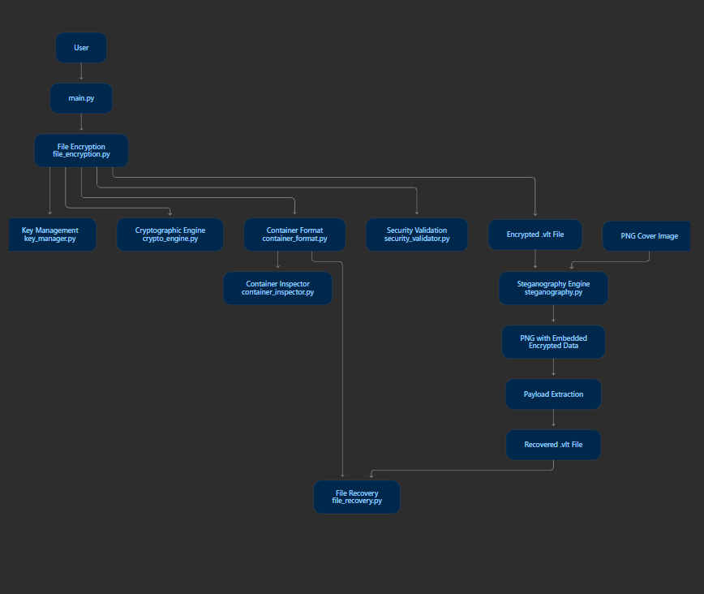

# Secure File Vault

**A Python-based secure file encryption and recovery system with PNG steganography.**

Secure File Vault is a desktop-oriented file security project designed to protect files through authenticated encryption, secure key management, integrity verification, and recovery mechanisms. It also supports hiding encrypted vault files inside PNG images using least significant bit (LSB) steganography.

## Key Features

- **File Encryption:** AES-GCM-based authenticated encryption for protecting files.
- **Secure Key Management:** Password-based key derivation using Argon2.
- **File Recovery:** Dedicated recovery functionality for encrypted vault files.
- **Integrity Verification:** Detects corrupted or tampered encrypted data.
- **PNG Steganography:** Embeds encrypted `.vlt` files inside PNG images using LSB encoding.
- **Container Inspection:** Inspects vault container information.
- **Atomic File Operations:** Uses temporary files and controlled output publishing to reduce incomplete-output risks.
- **Automated Testing:** Includes unit and integration tests for core functionality and security-related behavior.

## Technology Stack

| Technology | Purpose |
|---|---|
| Python | Core implementation |
| Cryptography | AES-GCM encryption |
| Argon2 | Password-based key derivation |
| Pillow | PNG image processing |
| Pytest | Automated testing |

## Project Structure

```text
Secure-File-Vault/
│
├── engine/
│   ├── container_format.py
│   ├── container_inspector.py
│   ├── crypto_engine.py
│   ├── file_encryption.py
│   ├── file_recovery.py
│   ├── key_manager.py
│   ├── security_validator.py
│   └── steganography.py
│
├── tests/
│   ├── test_container_format.py
│   ├── test_container_inspector.py
│   ├── test_crypto.py
│   ├── test_file_encryption.py
│   ├── test_file_recovery.py
│   ├── test_fsync_durability.py
│   ├── test_key_manager.py
│   ├── test_security_validator.py
│   ├── test_steganography.py
│   ├── test_steganography_integration.py
│   └── test_temp_cleanup.py
│
├── main.py
├── requirements.txt
└── .gitignore
```

## Installation

### 1. Clone the repository

```bash
git clone https://github.com/Guhan-VS/Secure-File-Vault.git
cd Secure-File-Vault
```

### 2. Create a virtual environment

```bash
python -m venv .venv
```

### 3. Activate the environment

**Windows PowerShell:**

```powershell
.venv\Scripts\Activate.ps1
```

### 4. Install dependencies

```bash
python -m pip install -r requirements.txt
```

## Testing

Run the automated test suite:

```bash
python -m pytest
```

The project has previously completed a reported test run of **260 passing tests**, including encryption, recovery, steganography, and integration tests.

## Security Design

The project incorporates several security mechanisms:

- Authenticated encryption using AES-GCM.
- Password-based key derivation using Argon2.
- SHA-256 integrity checks for embedded payloads.
- Validation of encrypted container metadata.
- Temporary-file handling and controlled output creation.
- Tests for corrupted data, invalid passwords, and failed file operations.

**Important:** PNG steganography provides concealment, not encryption. Files should be encrypted before embedding. The steganography header checksum detects accidental corruption but is not a keyed authentication mechanism. AES-GCM provides authenticated encryption for the encrypted vault data.

## Current Development Status

The core encryption, key management, recovery, integrity validation, and PNG steganography components have been implemented and tested.

Further development may include:

- Post-quantum secure file sharing.
- Desktop graphical user interface.
- Additional integration and system testing.
- Application packaging and release documentation.

## Author

**Guhan V S**

GitHub: [@Guhan-VS](https://github.com/Guhan-VS)

## License

No license has been selected yet. All rights are reserved by default unless a license is added to this repository.